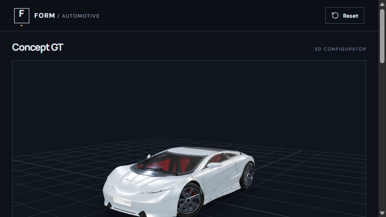
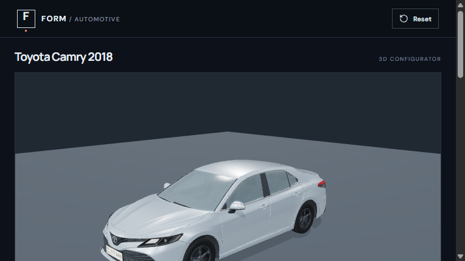
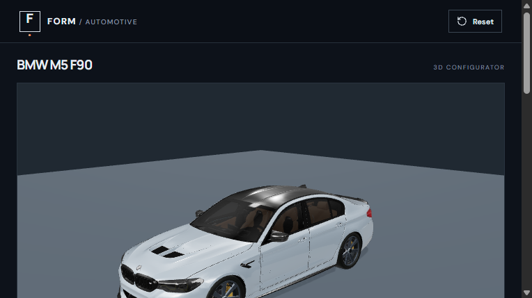

# Car Configurator 3D

A browser based 3D configurator for three vehicles. Choose a vehicle, inspect it with orbit and camera presets, adjust the options available for that model, save the configuration in the current browser, or export it as JSON. This is a visual prototype; it does not quote prices or accept orders.

## Screenshots

These are captures of the running application, including the selected wheel designs.

| Concept GT | Toyota Camry 2018 | BMW M5 F90 |
| --- | --- | --- |
|  |  |  |

## Supported vehicles and options

| Option | Concept GT | Toyota Camry 2018 | BMW M5 F90 |
| --- | :---: | :---: | :---: |
| Body color and finish | Yes | Yes | Yes |
| Wheel design and rim finish | Yes | Yes | Yes |
| Window tint | Yes | Yes | No |
| Carbon styled hood | Yes¹ | Yes | No |
| Independent bumper finish | No | Yes | No |
| Demo Kyrgyz front and rear plates | Yes | Yes | No |
| Rear spoiler | Yes | Yes | No |
| Save, reset and JSON export | Yes | Yes | Yes |

¹ The Concept GT hood mesh also contains front fascia geometry. BMW plate controls are intentionally disabled after visual review. The app offers Original, Deep Concave, Double-Spoke and Y-Spoke wheel selections for BMW; available choices for the other vehicles are shown in the UI.

## Technology

React 19, TypeScript, Vite 7, Three.js, React Three Fiber and Drei. Models are local GLB assets; Basis transcoder files support compressed textures. Save uses browser `localStorage`, with separate configurations per vehicle. No server, account, payment flow or inventory integration is included.

## Install and run

Use Node.js 20.19+ or 22.12+ and npm. The three active GLBs must be present at the paths below before building; the BMW file is part of the proposed release changes and is not yet committed.

```text
public/models/CarConcept.glb
public/models/candidates/ToyotaCamry2018_WheelLOD_v1.glb
public/models/candidates/bmw-m5-f90/bmw_m5_f90.glb
```

```bash
npm ci
npm run dev
```

Open `http://localhost:5173/`. The development server binds to all interfaces by default; restrict access with `npm run dev -- --host 127.0.0.1` if needed.

## Checks and production build

```bash
npx tsc --noEmit
npm run test:vehicles
npm run validate:assets
npm run build
npm run preview
```

`npm run build` produces `dist/`. The build configuration copies only the three active GLBs, the two Basis transcoder files, and their LICENSE and NOTICE into that output. Deploy `dist/` at the site root: model URLs are absolute paths beginning with `/models/`. Serve `.glb` and `.wasm` files and use HTTPS in production. The Google Fonts stylesheet is fetched from Google; blocking it falls back to local system fonts.

## Known limitations

- Camry (34.2 MB, about 875k triangles) and BMW (39.4 MB) exceed the project's proposed web transfer budget. Initial loading can be slow on mobile or constrained networks.
- The physical scale of the models has not been independently verified. Plate geometry is demonstrational and is not a legal registration check.
- BMW window tint, carbon hood, independent bumpers, plates and spoiler are unavailable because their geometry or visual acceptance is unresolved.
- Some Camry and Concept options still require full manual visual review on desktop and mobile devices.
- Browser save is local to one browser and device. Export creates JSON, not a rendered image; import is unavailable.
- The project and model marks are subject to separate trademark review before a public or commercial release. See [ATTRIBUTION.md](ATTRIBUTION.md).

## Credits and release status

The model credits, source links, license terms and changes are recorded in [ATTRIBUTION.md](ATTRIBUTION.md). The current working tree is a release candidate under audit; documentation here does not imply that publication has been approved.

This is an independent, unofficial 3D configurator created for demonstration and educational purposes. It is not affiliated with, sponsored by, or endorsed by BMW or Toyota. All trademarks belong to their respective owners.
